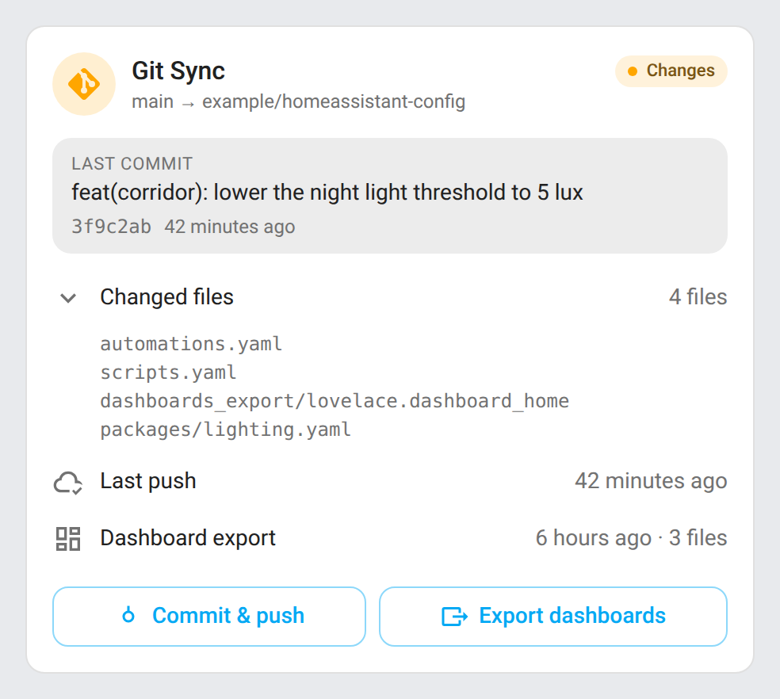
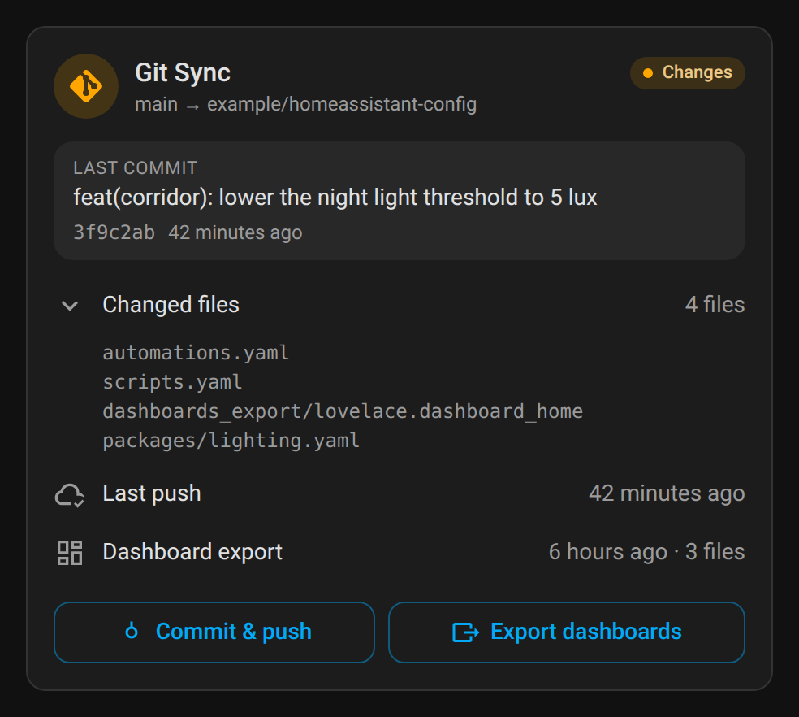
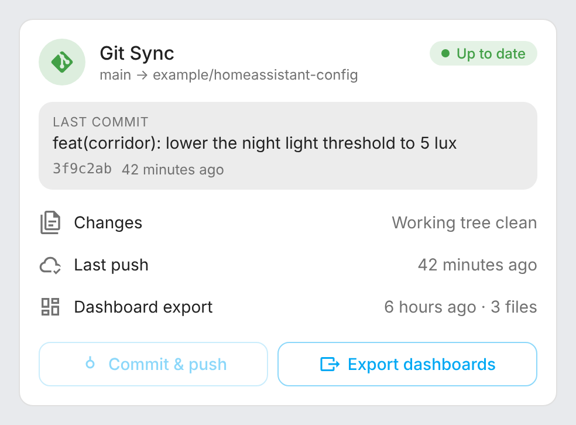
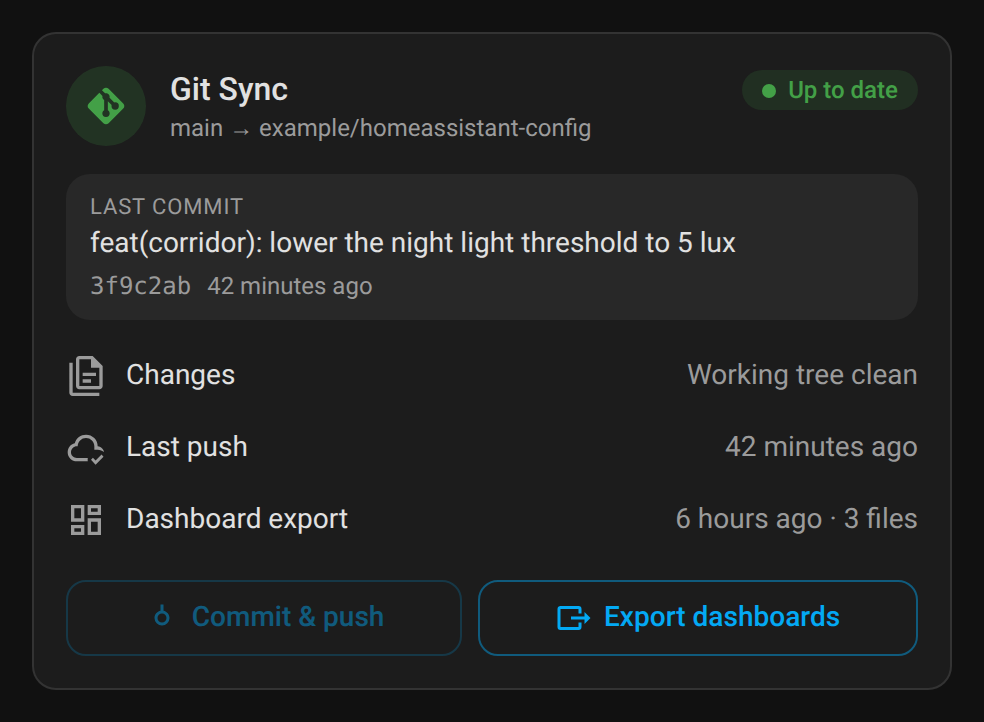
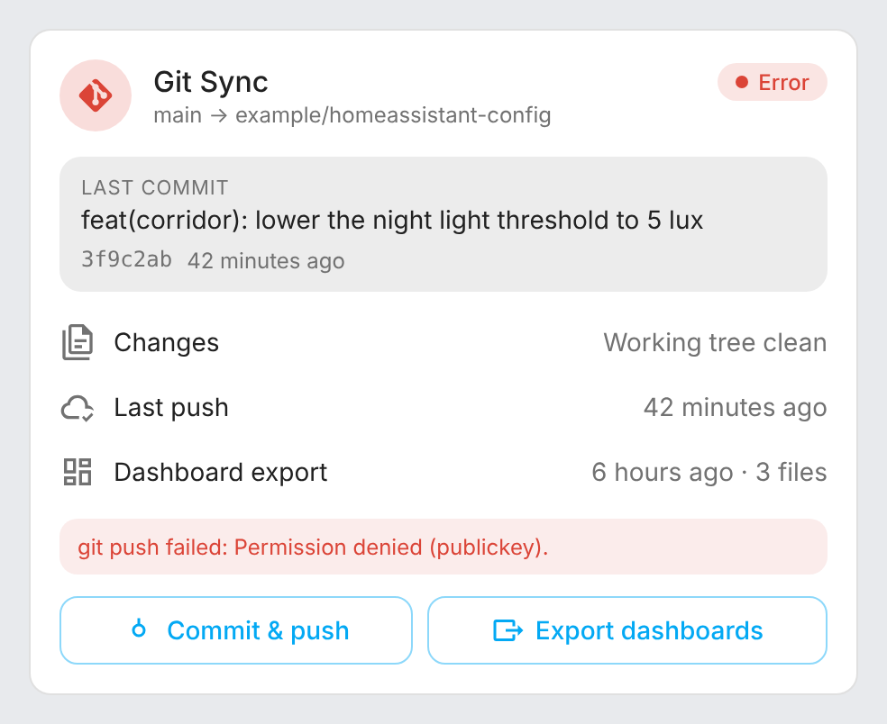
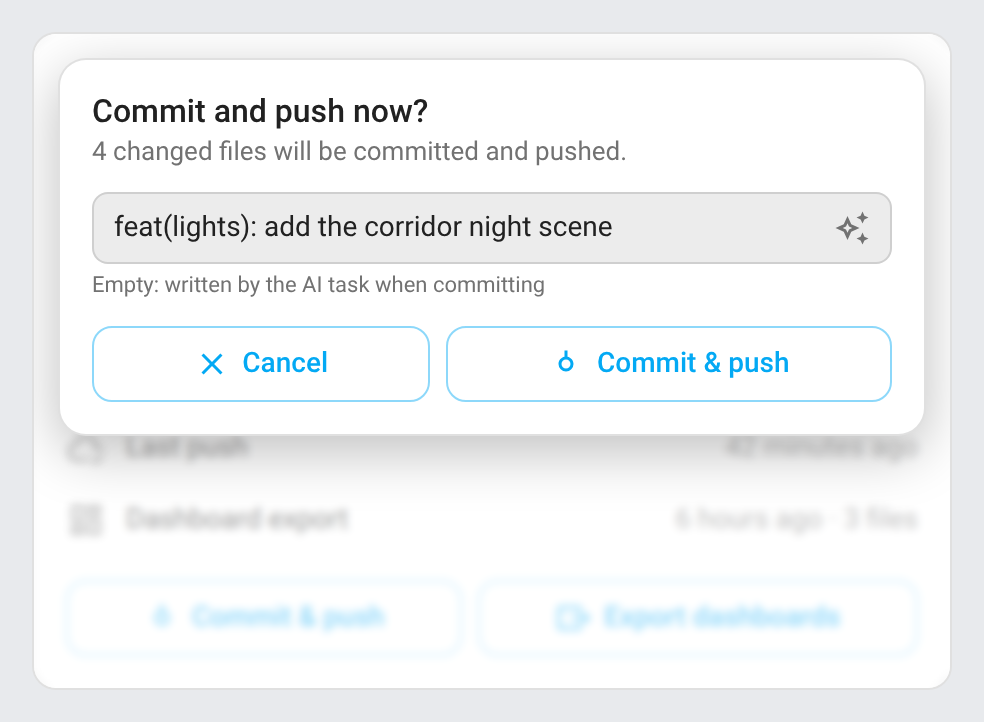
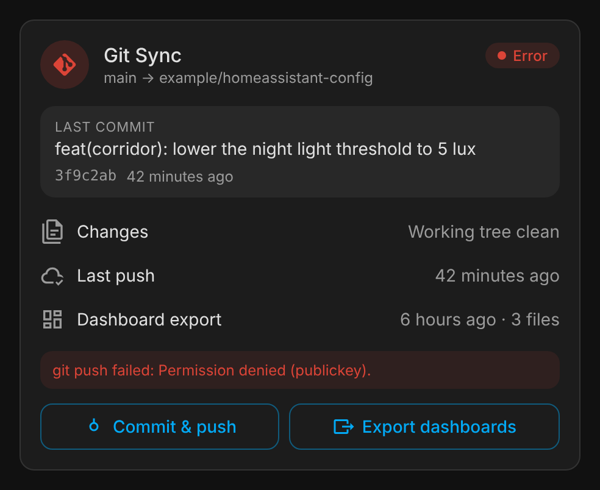
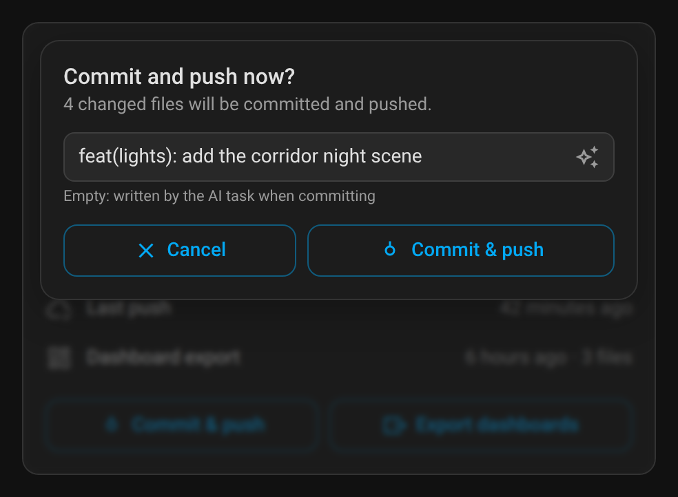

# ha-git-sync

[](https://github.com/hacs/integration)
[](https://github.com/juju35/ha-git-sync/actions/workflows/hacs.yml)
[](https://github.com/juju35/ha-git-sync/actions/workflows/validate.yml)
[](https://github.com/juju35/ha-git-sync/releases/latest)
[](LICENSE)

<p align="center"></p>

Home Assistant integration that versions your configuration with Git: it commits and pushes the changes on a schedule with an AI-written commit message, exports your dashboards out of `.storage`, and comes with a Lovelace card to follow and drive it all.

<p align="center">
  
  
</p>

It replaces the usual stack of `shell_command`, `command_line` sensor, script and automations around `git`, with nothing to write in YAML.

[](https://my.home-assistant.io/redirect/hacs_repository/?owner=juju35&repository=ha-git-sync&category=integration)

## Features

- **Status** of the work tree: clean, changes pending, push pending or error, with the changed files, the branch and the remote
- **Automatic commit and push** every N minutes (60 by default) when something changed, and on demand from a button, an action or the card
- **AI commit messages**: the staged diff is sent to an `ai_task` entity (Google, OpenAI, Ollama…), which writes a one-line [Conventional Commits](https://www.conventionalcommits.org/) message in English, French, German or Spanish. Without AI task, or if it fails, a generic message is used
- **Notification** after each real commit, with an optional image
- **Dashboard export**: copies `.storage/lovelace*` to a folder, as raw JSON, readable YAML or both, every day at a set time and optionally right before each commit. A file is only rewritten when it changes
- **SSH deploy key** created by an action; the push accepts the host key on first use, no `ssh-keyscan` needed
- A failed push stays visible on the status until a later push succeeds, and is retried at the next commit
- `git_sync_committed` and `git_sync_exported` **events**
- **Lovelace card** bundled with the integration: status, last commit, changed files, last push and export, Commit & push and Export dashboards
- English, French, German and Spanish

## Prerequisites

- Home Assistant 2024.12 or newer (the AI commit messages need the `ai_task` integration, 2025.8 or newer)
- `git` and `ssh` in the Home Assistant container: they are in the official images
- The configuration folder is a Git repository with a remote:

  ```bash
  cd /config
  git init -b main
  git remote add origin git@github.com:<you>/homeassistant-config.git
  ```

- A `.gitignore` keeping secrets and runtime files out of the repository, for example:

  ```gitignore
  secrets.yaml
  .storage/
  .cloud/
  .ssh/
  *.db*
  *.log*
  deps/
  tts/
  __pycache__/
  ```

> [!WARNING]
> Everything that is not ignored is pushed. Keep credentials in `secrets.yaml` (`!secret`) and prefer a **private** repository.

## Installation

### Via HACS (recommended)

Click the button below to add the repository directly:

[](https://my.home-assistant.io/redirect/hacs_repository/?owner=juju35&repository=ha-git-sync&category=integration)

Then click **Download** and restart Home Assistant.

Or manually:

1. Open HACS → **⋮** (top right) → **Custom repositories**
2. Add `https://github.com/juju35/ha-git-sync` — Type: **Integration**
3. Search for **Git Sync** and click **Download**
4. Restart Home Assistant

### Manual

Copy `custom_components/git_sync/` to `/config/custom_components/git_sync/`, then restart Home Assistant.

## Configuration

[](https://my.home-assistant.io/redirect/config_flow_start/?domain=git_sync)

**Settings → Devices & services → Add integration → Git Sync**. The repository settings can be changed later with **Reconfigure**, the options with **Configure**.

| Setting | Default | Description |
|---|---|---|
| Repository path | `/config` | Folder containing `.git`. One entry per repository |
| Remote | `origin` | Remote to push to |
| Branch | current branch | Target branch on the remote |
| SSH private key | `/config/.ssh/id_ed25519` | Key used for the push |
| Author name / email | repository config | Overrides `user.name` / `user.email` |

| Option | Default | Description |
|---|---|---|
| AI task entity | none | Writes the commit message from the diff. Without it: `chore: update configuration (n files)` |
| Commit message language | English | `en`, `fr`, `de` or `es` |
| Automatic commit interval | 60 min | Commit and push every N minutes when something changed, 0 to disable, up to 1440 |
| Status refresh interval | 60 s | How often `git status` is read, from 10 to 3600 |
| Notification action | none | Sent after each commit, for example `notify.mobile_app_phone` |
| Notification image URL | none | Absolute HTTPS URL (required by iOS) |
| Daily dashboard export | on | Export the dashboards every day |
| Export time | 08:00 | Time of the daily export |
| Export folder | `/config/dashboards_export` | Where the dashboards are written |
| Export format | JSON | JSON (raw copy of `.storage`), YAML (dashboard configuration only, easier to read in diffs) or both |
| Export before each commit | off | Also export right before each commit |

### SSH deploy key

1. **Developer tools → Actions** → `git_sync.generate_ssh_key` → **Perform action**: the response holds the public key (an existing key is kept)
2. On GitHub: repository → **Settings → Deploy keys → Add deploy key**, paste it and tick **Allow write access**

### Entities

| Entity | Description |
|---|---|
| `sensor.git_sync_<repo>_status` | `clean`, `dirty`, `ahead` (committed, push pending) or `error` (last push failed). Attributes: `branch`, `upstream`, `remote_url`, `ahead`, `behind`, `changed_count`, `changed_files` (first 50), `last_error`, `ai_task` |
| `sensor.git_sync_<repo>_changed_files` | Number of changed files |
| `sensor.git_sync_<repo>_last_commit` | Time of the HEAD commit. Attributes: `message`, `sha`, `short_sha` |
| `sensor.git_sync_<repo>_last_push` | Time of the last push made by Git Sync. Attribute: `message` |
| `sensor.git_sync_<repo>_last_export` | Time of the last dashboard export. Attribute: `files` |
| `sensor.git_sync_<repo>_branch` | Current branch (diagnostic) |
| `button.git_sync_<repo>_commit_and_push` | Commit and push now |
| `button.git_sync_<repo>_export_dashboards` | Export the dashboards now |

### Action `git_sync.commit_push`

Stages every change, commits and pushes. Without `message`, the AI task writes it. Returns whether a commit was made.

```yaml
action: git_sync.commit_push
data:
  message: "fix(corridor): lower the night light threshold"  # optional
response_variable: result  # {"results": [{"config_entry_id": "...", "committed": true, "message": "..."}]}
```

### Action `git_sync.generate_message`

Writes a commit message for the current changes with the AI task, **without committing**: the diff is computed on a copy of the Git index, so what you staged by hand stays as it is. Returns `null` when nothing changed; fails when no AI task is set in the options. This is what the ✨ button of the card calls.

```yaml
action: git_sync.generate_message
response_variable: result  # {"message": "feat(lights): add the corridor night scene"}
```

### Action `git_sync.export_dashboards`

```yaml
action: git_sync.export_dashboards
response_variable: result  # {"results": [{"config_entry_id": "...", "files": ["lovelace", ...]}]}
```

### Action `git_sync.generate_ssh_key`

```yaml
action: git_sync.generate_ssh_key
response_variable: key  # {"public_key": "ssh-ed25519 AAAA... homeassistant"}
```

Every action takes an optional `config_entry_id` to target one repository; without it, `commit_push` and `export_dashboards` run on all of them, `generate_message` and `generate_ssh_key` on the first one.

### Event `git_sync_committed`

| Field | Description |
|---|---|
| `entry_id` | Config entry of the repository |
| `message` | Commit message |
| `sha` | Commit hash |
| `files` | Number of files committed |

`git_sync_exported` gives `entry_id` and `files` (names of the exported files).

## Card

The integration serves the **Git Sync Card** and adds it to the dashboard resources (or loads it on every page when the resources are managed in YAML): no separate install. Add it from the card picker, or:

```yaml
type: custom:git-sync-card
```

| Changes pending | Up to date |
|---|---|
|  |  |
|  |  |

| Push failed | Commit & push, message written by the ✨ button |
|---|---|
|  |  |
|  |  |

- **Header**: status (up to date, changes, push pending, error, working…), branch and remote repository
- **Last commit**: message, short hash and how long ago
- **Changed files**: collapsible list, folded again when you click elsewhere
- **Last push** and **Dashboard export**, with the number of exported files
- **Commit & push** opens a confirmation at the top of the card with a message box, as in VS Code: the placeholder names the branch, and the ✨ button inside it (shown when an AI task is set) writes the message for the current changes without committing, so you can read and edit it before **Commit & push**. Left empty, the AI task writes it when committing. **Enter** commits, **Escape** closes. **Export dashboards** runs the export right away. The result is shown in a toast

Every option is in the visual editor:

| Option | Default | Description |
|---|---|---|
| `entity` | found automatically | The **Status** sensor of the repository |
| `title` | Git Sync | Card title |
| `show_files` | `true` | Collapsible list of the changed files |
| `show_export` | `true` | Last export and the **Export dashboards** button |
| `language` | Home Assistant's | `en`, `fr`, `de` or `es` |

## Migrating from shell commands

Once Git Sync has pushed once, remove from your configuration:

- `shell_command`: `git_commit_push`, `git_status_check`, `git_stage_diff`, `git_commit_push_ai`, `export_dashboards`, `git_generate_ssh_key`, `git_show_ssh_key`, `add_github_known_host`
- the `command_line` **Git status** sensor, the commit script and the commit and dashboard export automations
- the `input_button` and `input_text` helpers used for the manual push and the last push or export time, and the `git_push.sh` script

Point Git Sync to the same key (`/config/.ssh/id_ed25519`) and export folder to keep your deploy key and history.

## How it works

Git Sync runs the `git` command line in the configuration folder. Every status interval it reads `git status`, the HEAD commit and the remote. A commit stages everything (`git add -A`), sends the statistics and the first 8000 characters of the diff to the AI task, keeps the first line of its answer without quotes, backticks or dollar signs (100 characters max), commits and pushes. Commits and exports never run at the same time. The last push and export are kept across restarts.

To debug:

```yaml
logger:
  logs:
    custom_components.git_sync: debug
```

## Development

```bash
pip install -r requirements_test.txt && pytest
node --test test/*.test.mjs        # card
python scripts/screenshots.py      # README screenshots (Playwright)
```

### Releasing

1. Bump the version in `custom_components/git_sync/manifest.json`, `const.py` (`VERSION`) and the card (`GIT_SYNC_CARD_VERSION`)
2. Add a `## <version>` section at the top of [CHANGELOG.md](CHANGELOG.md)
3. Push to `main`: the **Release** workflow creates the tag and the GitHub release with the changelog section as notes

## Translations

The integration and its card follow the language of Home Assistant. Currently supported:

| Language | Code |
|---|---|
| English | `en` |
| Français | `fr` |
| Deutsch | `de` |
| Español | `es` |

Contributions for additional languages are welcome!

## License

[MIT](LICENSE)
